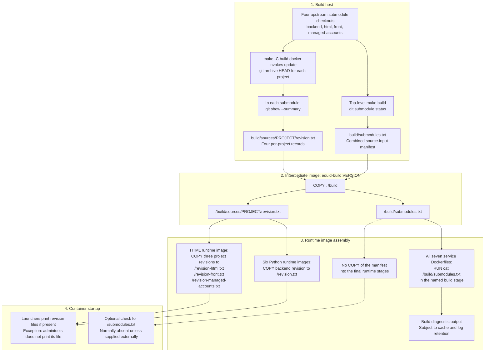

# Generated Provenance Files

## Purpose and Scope

Describe the provenance files explicitly generated by releng: where their data
comes from, when they are written, how they pass through the image build, and
where they are available for troubleshooting.

The current implementation has two mechanisms, producing five host-side files:

- Four per-project `revision.txt` files containing upstream commit metadata.
- One `build/submodules.txt` manifest listing all selected submodule commits.

These are diagnostic records of source inputs, not formal build attestations.
This inventory covers releng-owned generation commands, not metadata that
package managers, compilers, Docker, or upstream applications may generate
internally.

## Implementation References

- [Top-level build orchestration](../../Makefile)
- [Source export and revision generation](../../build/Makefile)
- [Intermediate image assembly](../../build/Dockerfile)
- [Frontend artifact build](../../build/build-js.sh)
- [Python environment build](../../build/setup-venv.sh)
- [Generated-file exclusions](../../.gitignore)
- [Runtime image contract](../contracts/runtime-image-contract.md)

## End-to-End Diagram

Arrows represent file or diagnostic-output flow, not image inheritance.
The manifest is captured before source export in the top-level build recipe.



## File Inventory

Paths in the first column are relative to the repository root on the host.
The intermediate image receives them through `COPY . /build`.

| Generated host file | Information source | Path inside intermediate image |
| --- | --- | --- |
| `build/submodules.txt` | `git submodule status` in releng | `/build/submodules.txt` |
| `build/sources/eduid-backend/revision.txt` | Backend submodule `HEAD` | `/build/sources/eduid-backend/revision.txt` |
| `build/sources/eduid-html/revision.txt` | HTML submodule `HEAD` | `/build/sources/eduid-html/revision.txt` |
| `build/sources/eduid-front/revision.txt` | Frontend submodule `HEAD` | `/build/sources/eduid-front/revision.txt` |
| `build/sources/eduid-managed-accounts/revision.txt` | Managed-accounts submodule `HEAD` | `/build/sources/eduid-managed-accounts/revision.txt` |

The host files are generated outputs excluded by `.gitignore`. They are not
maintained manually or committed as release records.

## Per-Project Revision Records

### Production

The `update` target in [build/Makefile](../../build/Makefile) exports each
submodule's `HEAD` with `git archive`. After each export, it runs
`git show --summary` in that submodule and redirects the output to
`revision.txt` in the corresponding exported source root.

The redirection overwrites that destination, including any same-named file
that might have been included in the archive.

The `docker` target depends on `update`, so these files are regenerated before
building `eduid-build:VERSION`. The exported trees do not need upstream Git
history inside the image to retain this metadata.

### Contents and Meaning

Each file contains the upstream commit ID and associated metadata, normally
including author, date, commit message, and any summary information emitted by
`git show --summary`.

It answers:

> Which upstream commit was exported for this project?

It does not describe the releng commit or all contents of a final image.

### Final Image Destinations

| Final image | Upstream record copied | Destination |
| --- | --- | --- |
| [webapp](../../images/webapp/Dockerfile) | `eduid-backend` | `/revision.txt` |
| [worker](../../images/worker/Dockerfile) | `eduid-backend` | `/revision.txt` |
| [fastapi](../../images/fastapi/Dockerfile) | `eduid-backend` | `/revision.txt` |
| [satosa_scim](../../images/satosa_scim/Dockerfile) | `eduid-backend` | `/revision.txt` |
| [admintools](../../images/admintools/Dockerfile) | `eduid-backend` | `/revision.txt` |
| [vccs](../../images/vccs/Dockerfile) | `eduid-backend` | `/revision.txt` |
| [html](../../images/html/Dockerfile) | `eduid-html` | `/revision-html.txt` |
| [html](../../images/html/Dockerfile) | `eduid-front` | `/revision-front.txt` |
| [html](../../images/html/Dockerfile) | `eduid-managed-accounts` | `/revision-managed-accounts.txt` |

All copies preserve the generated contents. VCCS does not append its Luna
base-image tag.

The service launchers print these records when present, except admintools.
VCCS prints its record through the shared FastAPI launcher. HTML labels and
prints its three records separately.

See [Revision Metadata Flow](revision-metadata-flow.md) for the dedicated
revision-file walkthrough and launcher references.

## Combined Submodule Manifest

### Production

The top-level [Makefile](../../Makefile) writes:

```sh
git submodule status > build/submodules.txt
```

This happens in the `build` recipe after its `build_prep` and `prebuild`
prerequisites, and before invoking the nested build-image target.

Running `make -C build docker` directly regenerates the revision records but
does not itself regenerate this manifest. A pre-existing manifest can therefore
be stale; if absent, the runtime Dockerfiles' `cat` commands cannot read it.

### Contents and Meaning

Each line contains a submodule commit SHA, its path, and, when available, a
descriptive Git reference. The leading status character has meaning:

| Prefix | Meaning |
| --- | --- |
| Space | Checked-out commit matches the submodule commit recorded in the index |
| `+` | Checked-out commit differs from the one recorded in the index |
| `-` | Submodule is not initialized |
| `U` | Submodule has merge conflicts |

This is a compact overview of the selected upstream commits. It is not a
complete record of uncommitted changes inside each submodule and does not
select or enforce the revisions used by later commands.

### Build-Time and Runtime Availability

The intermediate image contains `/build/submodules.txt`. All seven service
Dockerfiles declare `eduid-build:VERSION` as a named stage and run:

```dockerfile
RUN cat /build/submodules.txt
```

This requests diagnostic output during image assembly. Cached build steps and
the builder's output mode can affect whether the contents appear in a
particular build log.

No current service Dockerfile copies this manifest into its final stage.
The separate final stage does not automatically inherit files from the named
build stage.

The webapp, worker, FastAPI, SATOSA, and HTML launchers nevertheless check
`/submodules.txt` and print it if present. VCCS uses the FastAPI launcher.
These checks normally print nothing because releng does not populate that
runtime path. An external mount or another external mechanism could supply it.
Admintools has no such startup check.

## Similar Information That Is Not a Generated Provenance File

| Mechanism | Actual role |
| --- | --- |
| `uv pip freeze` in environment setup and service launchers | Prints installed Python package versions to logs; releng does not redirect this output to an inventory file |
| `VERSION` and Docker image tags | Identify release images; not generated provenance files |
| Files under `versions/` | Tracked base-image and toolchain inputs, not generated records of resolved image contents |
| [SATOSA overlay manifest](../../images/satosa_scim/patches/manifest.txt) | Tracked instructions identifying overlays to apply, not an output inventory |
| Upstream frontend revision files | Separate upstream build outputs, described below; their generation is bypassed by the current releng frontend build |

The standalone `make build` targets in the upstream frontend repositories
write `build/revision.txt` for `eduid-front` and `dist/revision.txt` for
`eduid-managed-accounts`. They record branch name, `git describe --always`
output, and the latest commit details.

Releng's [build-js.sh](../../build/build-js.sh) invokes the frontend npm scripts
or Vite directly, not those Makefile targets. These upstream generators are
therefore not the producers of releng's root-level runtime revision records.

## Limitations and Operational Interpretation

Use these files as source-tracing breadcrumbs, with the following limits:

- Neither mechanism records the releng commit.
- Neither inventories OS packages, all Python or JavaScript dependencies,
  compiler versions, or resolved base-image digests.
- Neither binds the recorded inputs cryptographically to a final image digest.
- The manifest capture, source exports, and per-project revision commands are
  separate operations, not an atomic snapshot. Changing submodule checkouts
  during the build can make the records inconsistent.
- Commit metadata does not describe runtime changes such as development mounts
  or packages installed at startup.
- Host-side files are overwritten on subsequent generation. They are not a
  historical release archive.
- This repository does not explicitly generate an SBOM, signed provenance
  attestation, or image-digest manifest in its current build scripts or CI
  workflow.

For troubleshooting, inspect the revision files in the final image to identify
its upstream source commits. Use the matching intermediate image's
`/build/submodules.txt`, or retained build output when available, for the
combined submodule snapshot. Do not assume that the host's current generated
files still correspond to an older deployed image.
