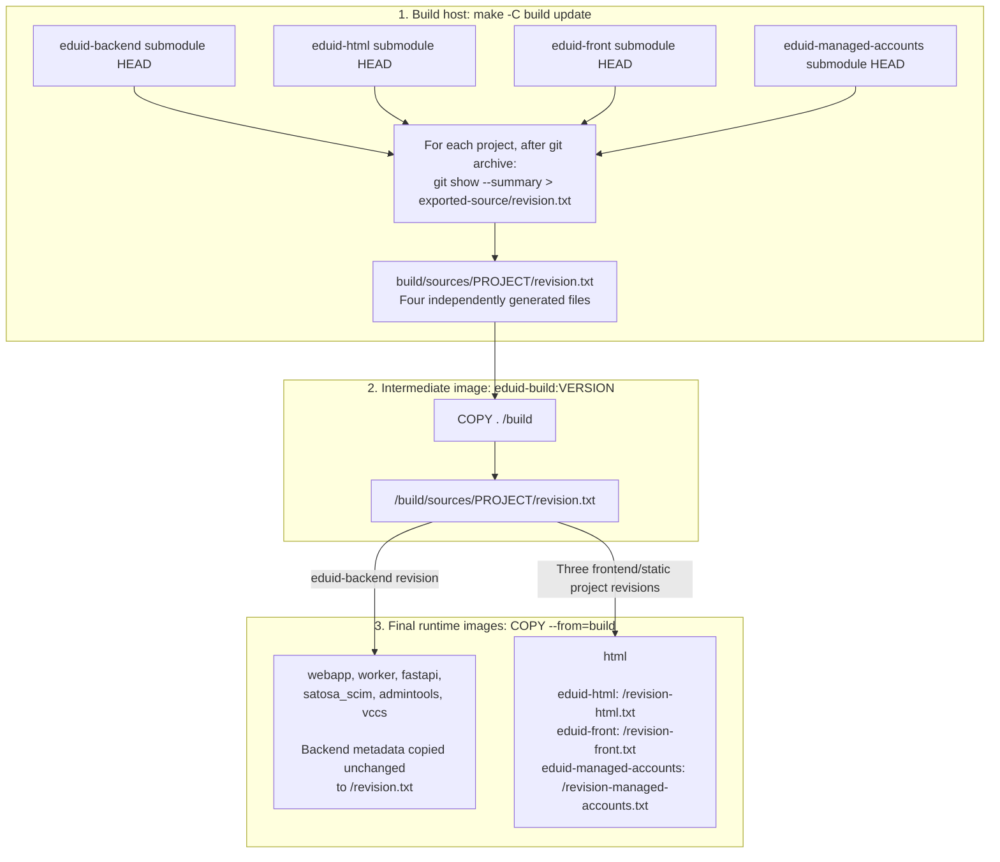

# Revision Metadata Flow

## Purpose

Explain where `revision.txt` is produced, how it reaches the final runtime
images, and what its contents mean.

## Implementation References

- [Source export and revision generation](../../build/Makefile)
- [Intermediate build image](../../build/Dockerfile)
- [Runtime image contract](../contracts/runtime-image-contract.md)

## Diagram

The host generates one revision file per upstream project. The intermediate
image carries those files, and each final image copies the relevant metadata.
Arrows show file flow, not image inheritance.



## Step-by-Step Explanation

### 1. Produce the files on the build host

The `update` target in [build/Makefile](../../build/Makefile) exports each
submodule's current `HEAD` using `git archive`. It then runs `git show --summary`
inside that same submodule and redirects the output to the exported tree.

For example, the backend command is:

```sh
cd build/repos/eduid-backend && git show --summary > ../../sources/eduid-backend/revision.txt
```

This produces four files on the host:

| Upstream submodule | Generated file |
| --- | --- |
| `eduid-backend` | `build/sources/eduid-backend/revision.txt` |
| `eduid-html` | `build/sources/eduid-html/revision.txt` |
| `eduid-front` | `build/sources/eduid-front/revision.txt` |
| `eduid-managed-accounts` | `build/sources/eduid-managed-accounts/revision.txt` |

These files are generated build outputs, not files to edit manually.
The `docker` target depends on `update`, so source export and metadata generation
run before the intermediate image is built.

### 2. Carry the files through the intermediate image

The intermediate [build Dockerfile](../../build/Dockerfile) uses:

```dockerfile
COPY . /build
```

Its build context is the host's `build/` directory. Consequently, the generated
files become `/build/sources/PROJECT/revision.txt` inside `eduid-build:VERSION`.

The Dockerfile does not generate the revision files. It receives them from the
host alongside the exported source trees.

### 3. Copy the metadata into the final images

Each runtime Dockerfile declares `eduid-build:VERSION` as a named `build` stage.
It then copies selected files from that stage into its final runtime stage.

| Final image | Source inside `eduid-build:VERSION` | Destination inside final image |
| --- | --- | --- |
| [webapp](../../images/webapp/Dockerfile) | `/build/sources/eduid-backend/revision.txt` | `/revision.txt` |
| [worker](../../images/worker/Dockerfile) | `/build/sources/eduid-backend/revision.txt` | `/revision.txt` |
| [fastapi](../../images/fastapi/Dockerfile) | `/build/sources/eduid-backend/revision.txt` | `/revision.txt` |
| [satosa_scim](../../images/satosa_scim/Dockerfile) | `/build/sources/eduid-backend/revision.txt` | `/revision.txt` |
| [admintools](../../images/admintools/Dockerfile) | `/build/sources/eduid-backend/revision.txt` | `/revision.txt` |
| [vccs](../../images/vccs/Dockerfile) | `/build/sources/eduid-backend/revision.txt` | `/revision.txt` |
| [html](../../images/html/Dockerfile) | `/build/sources/eduid-html/revision.txt` | `/revision-html.txt` |
| [html](../../images/html/Dockerfile) | `/build/sources/eduid-front/revision.txt` | `/revision-front.txt` |
| [html](../../images/html/Dockerfile) | `/build/sources/eduid-managed-accounts/revision.txt` | `/revision-managed-accounts.txt` |

All six Python runtime images copy the backend revision metadata unchanged.
VCCS does not append its Luna base-image tag. That base is selected separately
through `VCCS_LUNA_IMAGE_REPO` and `VCCS_LUNA_IMAGE_TAG`.

Neither [eduid-prebuild](../../images/prebuild/Dockerfile) nor
[eduid-runtime-common](../../images/runtime_common/Dockerfile) explicitly creates
or copies these revision files.

### 4. Display the metadata at container startup

The startup scripts for
[webapp](../../images/webapp/start-webapp.sh),
[worker](../../images/worker/start-worker.sh),
[fastapi](../../images/fastapi/start-fastapi.sh), and
[satosa_scim](../../images/satosa_scim/start-satosa_scim.sh)
print `/revision.txt` if present.

[VCCS's wrapper](../../images/vccs/start-vccs.sh) delegates to the shared FastAPI
launcher, which prints the same file.
[HTML's launcher](../../images/html/start-html.sh) prints all three renamed
revision files with project labels.
[Admintools' launcher](../../images/admintools/start-admintools.sh) does not print
its revision file.

## Meaning and Limitations

`revision.txt` is a human-readable provenance record answering:

> Which upstream source commit was used for this build?

Its contents come from `git show --summary`: the commit ID and associated
metadata, normally including the author, date, commit message, and any summary
information. It is not just a commit SHA.

The file does not identify:

- the releng repository commit;
- the Docker release tag or image digest;
- the complete set of installed dependencies or operating-system packages;
- the runtime base-image revision;
- runtime overrides, such as mounted development source.

It is useful for startup diagnostics and deployment comparisons, but it is not
a formal build attestation or proof of the code currently executing.
