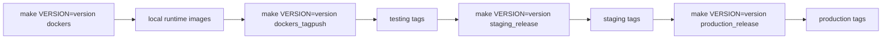

# Promotion Operations

## Purpose

Document how already-built images move from testing to staging and production.

## Source Of Truth

- `Makefile`
- `images/*/Makefile`

## Promotion Overview



## Current Promotion Steps

### Promote to staging

```bash
make VERSION=<version> staging_release
```

For most images, this pulls `$(VERSION)-testing`, retags it as
`$(VERSION)-staging`, and pushes the staging tag. For `admintools`, the tags
are `testing` and `staging` without a version prefix.

### Promote to production

```bash
make VERSION=<version> production_release
```

For most images, this pulls `$(VERSION)-staging`, retags it as
`$(VERSION)-production`, and pushes the production tag. For `admintools`, the
tags are `staging` and `production` without a version prefix.

## Services Included

Promotion covers:

- `webapp`
- `worker`
- `satosa_scim`
- `fastapi`
- `admintools`
- `html`
- `vccs`

## Important Current Property

Promotion does not rebuild images. It only retags previously built images.

Check the `admintools` source tag separately before each promotion. The supplied
version does not select that image; promotion uses whichever image currently
has the source tag.

## Current Limitation

The repo promotes by tag. It does not yet define a digest-based promotion contract or first-class attestation flow.